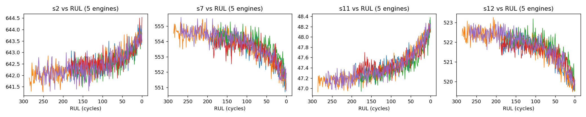
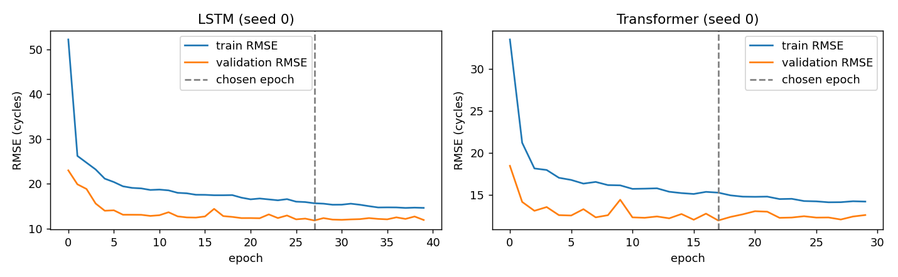
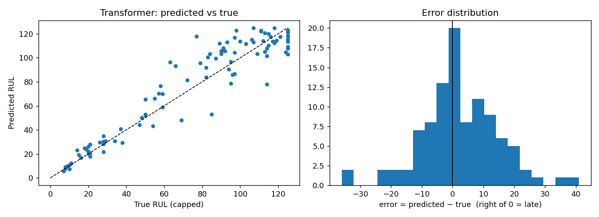
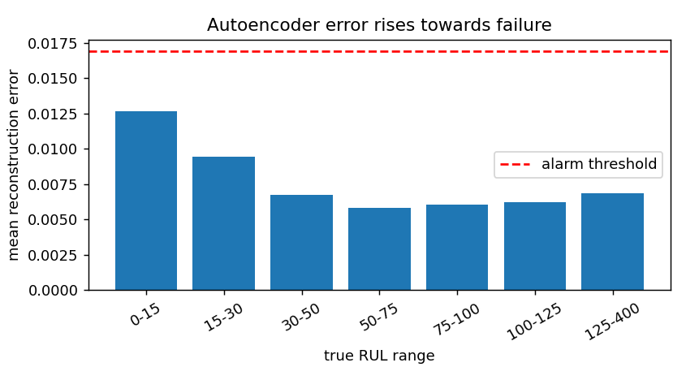

# Aircraft Engine Predictive Maintenance: Remaining Useful Life (RUL) on NASA C-MAPSS

Predicting how many flight cycles a turbofan engine can still run before failure, using multivariate sensor time series, plus an unsupervised autoencoder that flags degradation.

The project is built to be **honest and reproducible**: leakage-free evaluation, classical baselines, multiple random seeds, bootstrap confidence intervals, ablations, and a clear account of what did *not* work.

**Stack:** Python, PyTorch, Scikit-Learn, Pandas, NumPy, Matplotlib

---

## Highlights

- **Leakage-free pipeline:** train/validation split by *engine* (not by row), scaler fit on training engines only, test set evaluated once after all choices were made.
- **Real baselines:** mean predictor, Ridge regression, and a Random Forest on engineered window features.
- **Two sequence models:** a 2-layer LSTM and a Transformer encoder, trained with early stopping on held-out validation engines and averaged over 3 seeds.
- **Result:** both neural models cut RMSE by about **67–70% versus the mean-predictor baseline** (FD001: 13.4 and 13.1 vs 40.6) and are **comparable to a well-engineered Random Forest** (12.8). Differences of under one RMSE point are inside the bootstrap confidence intervals.
- **Ablation:** sinusoidal **positional encoding** reduces Transformer RMSE from **15.9 to 12.9** and the NASA score from 692 to 299.
- **Negative result, reported honestly:** a model trained on FD001 does not transfer zero-shot to FD003 (RMSE 39–49, no better than predicting the mean).

---

## Dataset

[NASA C-MAPSS turbofan engine degradation simulation](https://data.nasa.gov/dataset/c-mapss-aircraft-engine-simulator-data) (Saxena & Goebel, 2008). Each engine is run from healthy to failure; the dataset gives 21 sensor channels per flight cycle.

| Subset | Train engines | Test engines | Operating conditions | Fault modes | Sensors used |
|---|---|---|---|---|---|
| FD001 | 100 | 100 | 1 | 1 (HPC degradation) | 15 |
| FD003 | 100 | 100 | 1 | 2 (HPC + fan degradation) | 16 |

Sensors with no variation in the training data are dropped automatically. FD002 and FD004 (six operating conditions) are not covered.

The data is not included in this repository. Download it from NASA's Prognostics Data Repository and place `train_FDxxx.txt`, `test_FDxxx.txt`, and `RUL_FDxxx.txt` (for FD001 and FD003) next to the notebook. The notebook locates them automatically.

---

## Method

**Target.** RUL is capped at 125 cycles (piecewise-linear). Early in life engines show no measurable degradation, so distinguishing RUL 300 from RUL 200 is not learnable. The same cap is applied to test labels; all reported metrics are against capped RUL.

**Inputs.** Sliding windows of 30 consecutive cycles over the selected sensors. At test time, the last 30 cycles of each test engine are used (short engines are padded by repeating the first row).

**Splitting and scaling.** 20% of the training engines are held out for validation and early stopping (fixed split, seed 42). A MinMax scaler is fit on training engines only.

**Baselines**

| Model | Details |
|---|---|
| Mean predictor | Always predicts the training mean RUL |
| Ridge | Linear regression on the flattened window |
| Random Forest | 200 trees on engineered features: last value, mean, std and slope per sensor |

**Neural models** (same training recipe for a fair comparison)

| | LSTM | Transformer |
|---|---|---|
| Architecture | 2 layers, hidden size 64, dropout 0.2 | 2 encoder layers, 4 heads, d_model 64, feed-forward 128, dropout 0.1, pre-norm, sinusoidal positional encoding |
| Readout | Last time step to MLP head | Last token + mean pooling to MLP head |
| Parameters (FD001) | 56,129 | 72,129 |

Training: AdamW (lr 1e-3, weight decay 1e-4), batch size 256, gradient clipping at 1.0, ReduceLROnPlateau, up to 80 epochs with early stopping (patience 12) on validation RMSE, best checkpoint restored. Seeds 0, 1, 2.

**Metrics.** RMSE, MAE, R², the asymmetric **NASA PHM08 score** (penalises late predictions more heavily than early ones), and the percentage of late predictions (predicted RUL greater than true RUL). Seed-ensemble RMSE comes with a 95% bootstrap confidence interval over test engines.

---

## Results

All numbers are on the official test engines. Per-seed results are mean ± std over 3 seeds.

### FD001 → FD001 (main result)

| Model | RMSE | MAE | R² | NASA score | Late % | RMSE vs mean predictor |
|---|---|---|---|---|---|---|
| Mean predictor | 40.58 | 35.07 | -0.025 | 18,669 | 45 | n/a |
| Ridge | 14.72 | 11.91 | 0.865 | 363 | 54 | -63.7% |
| Random forest | **12.81** | **9.30** | **0.898** | **259** | 60 | -68.4% |
| LSTM | 13.38 ± 0.17 | 9.96 ± 0.18 | 0.889 ± 0.003 | 310 ± 16 | 58 ± 4 | -67.0% |
| Transformer | 13.14 ± 0.55 | 9.77 ± 0.48 | 0.892 ± 0.009 | 308 ± 50 | 61 ± 4 | -67.6% |

95% bootstrap CIs on seed-ensemble RMSE: Random forest [10.26, 15.18], LSTM [11.08, 15.42], Transformer [10.57, 14.94]. The intervals overlap almost completely, so **the three best models cannot be separated with 100 test engines.**

### FD003 → FD003

| Model | RMSE | MAE | NASA score |
|---|---|---|---|
| Mean predictor | 42.17 | 35.44 | 39,802 |
| Ridge | 16.31 | 13.31 | 514 |
| Random forest | **12.18** | **8.70** | **270** |
| LSTM | 12.59 ± 0.67 | 8.71 ± 0.91 | 339 ± 31 |
| Transformer | 13.54 ± 0.79 | 9.16 ± 0.71 | 474 ± 113 |

### Zero-shot transfer: FD001 → FD003

| Model | RMSE | NASA score |
|---|---|---|
| Mean predictor | 39.80 | 17,382 |
| Random forest | 19.39 | 2,266 |
| Transformer | 38.72 ± 3.54 | 82,142 ± 43,500 |
| LSTM | 49.11 ± 0.03 | 1,017,761 ± 36 |
| Ridge | 53.62 | 1,029,729 |

Models trained on FD001 do not transfer to FD003. The likely reasons are the second fault mode (fan degradation) and different sensor ranges, so FD001's scaling and learned patterns do not carry over. Transfer would need per-dataset scaling, fine-tuning on FD003, or domain adaptation.

### Ablations (FD001, 2 seeds)

| Variant | RMSE | NASA score |
|---|---|---|
| Transformer with positional encoding | **12.89 ± 0.49** | **299 ± 68** |
| Transformer without positional encoding | 15.88 ± 0.35 | 692 ± 33 |
| LSTM, window 20 | 15.74 ± 0.35 | 606 ± 30 |
| LSTM, window 30 | **13.45 ± 0.15** | **317 ± 13** |
| LSTM, window 50 | 13.75 ± 0.93 | 324 ± 20 |

Without positional encoding, attention has no notion of the order of the 30 cycles, which is why my first Transformer overfit and underperformed.

### Anomaly detection

A dense autoencoder is trained only on healthy windows (RUL ≥ 125) of the training engines. The alarm threshold is the 99th percentile of reconstruction error on healthy windows of held-out validation engines (no test data used).

- AUROC separating near-failure windows (RUL ≤ 30) from healthy windows on the test engines: **0.76**.
- F1 at the chosen threshold: **0.09**.

Reconstruction error rises only in the final ~30 cycles, and the conservative threshold sits above every RUL bin's mean error, so alarms fire rarely. The autoencoder is a **late degradation signal, not a ready-to-deploy detector** (see Limitations).

---

## Figures

**Sensor trajectories against RUL (five engines).** Several sensors drift steadily as the engine approaches failure.

**Learning curves.** Train vs validation RMSE per epoch; the dashed line marks the checkpoint chosen by early stopping.

**Predicted vs true RUL and error distribution** for the better neural model on FD001 (seed-ensemble). Points right of zero in the histogram are late predictions.

**Autoencoder reconstruction error by true RUL range.** Error rises only in the final ~30 cycles, and the alarm threshold (red) sits above every bar.

---

## Key takeaways

1. A **sequence model is not automatically better than a good tabular baseline** on a dataset this small; a Random Forest on simple window statistics matched the LSTM and Transformer.
2. **Architecture details matter more than model choice:** positional encoding was worth ~3 RMSE points for the Transformer.
3. **Report the direction of error:** 58–61% of predictions are late (over-optimistic), which is the risky direction in maintenance. This is what the NASA score is designed to capture.
4. **Distribution shift is real:** a model trained on one subset can fail badly on another.

---

## Limitations

- Only 100 test engines per subset, so differences of about 1 RMSE point are within noise.
- RUL is capped at 125; errors against uncapped RUL would be larger.
- Only single-operating-condition subsets (FD001, FD003) are covered.
- Validation uses one fixed engine split; k-fold cross-validation by engine would be more robust.
- The autoencoder detector has low recall at its threshold; calibration and a sequence-based autoencoder are untested.
- Hyperparameters were not tuned beyond the ablations above.

## Possible next steps

- Per-dataset scaling and fine-tuning for FD001 → FD003 transfer; extend to FD002/FD004 with per-condition normalisation.
- Calibrate the anomaly threshold on the precision/recall trade-off and smooth the error over time.
- Quantile or heteroscedastic loss to reduce late predictions directly; evaluate cross-validation by engine.

---

## Reproducing the results

1. Open `predictive_maintenance_RUL_final.ipynb` in Google Colab with a GPU runtime (or run locally with PyTorch, Scikit-Learn, Pandas, Matplotlib).
2. Set `QUICK = True` in the configuration cell for a fast smoke test, then `QUICK = False` for the final numbers.
3. Run all cells. The notebook finds the C-MAPSS `.txt` files, or asks you to upload the dataset zip in Colab.
4. Tables and figures are written to `outputs/` (`results_table.csv`, `per_seed_results.csv`, `ablations.csv`, and the PNG figures).

Seeds are fixed, but GPU nondeterminism means numbers can differ slightly between runs.

---

## References

- A. Saxena and K. Goebel (2008). *Turbofan Engine Degradation Simulation Data Set.* NASA Ames Prognostics Data Repository.
- A. Saxena, K. Goebel, D. Simon, N. Eklund (2008). *Damage Propagation Modeling for Aircraft Engine Run-to-Failure Simulation.* International Conference on Prognostics and Health Management.

## Author

Paramveer Singh. [GitHub](https://github.com/param2234) · [LinkedIn](https://linkedin.com/in/paramveer-singh)
